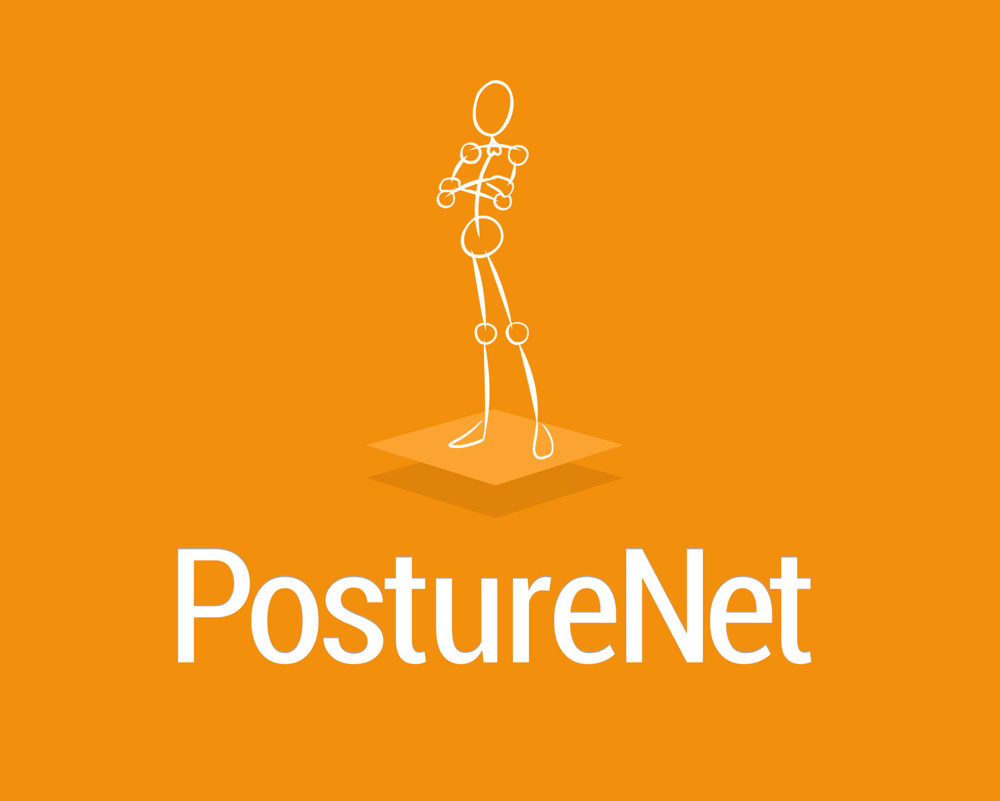

# PostureNet

### HackNC 2019 Healthiest Hack & Most Innovative Hack Runner Up

PostureNet uses your webcam and machine learning to check your posture while you work. It runs PoseNet pose estimation in the browser to check your head, shoulder, and leg posture, shows a card for each one, and tracks how long you've spent sitting and standing.

[Presentation Slides](https://docs.google.com/presentation/d/1OO_T4BK-tkrcCHk5EADHoAqVLLCWYaZP4yieB96uCGg/edit?usp=sharing)

The original hosted site, posturenet.tech, is currently offline.



## Tech

- [ml5.js](https://ml5js.org/) PoseNet for pose estimation (`public/sketch.js`)
- [p5.js](https://p5js.org/) for the webcam feed and drawing keypoints
- [Chart.js](https://www.chartjs.org/) and the Start Bootstrap SB Admin 2 template for the dashboard
- Firebase Hosting (`firebase.json` serves the `public/` folder)

## Run it locally

Everything is static and loads its libraries from CDNs, so there's nothing to install. From the repo root:

```sh
cd public
python3 -m http.server 8000
# then open http://localhost:8000/posture.html and allow camera access
```

Browsers only allow webcam access on `localhost` or HTTPS.
